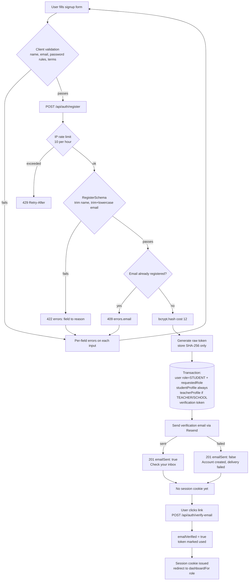
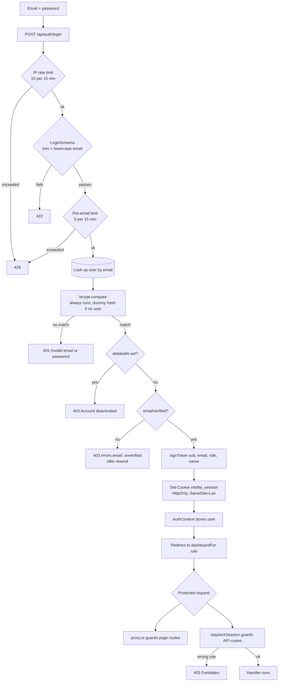

# Authentication System

Reference for how authentication and authorization work in Intellia360.
Last verified against the codebase on 2026-09-04.

---

## 1. Overview

Intellia360 is a single Next.js 16 application — there is no separate backend
service. "Frontend" and "backend" both live in `src/app`:

| Concern | Implementation |
| --- | --- |
| Framework | Next.js 16.2.12 (App Router, Turbopack) |
| UI | React 19 client components + plain CSS in `src/styles` |
| API | Route Handlers under `src/app/api/**/route.ts` (Node runtime) |
| Edge guard | `src/proxy.ts` — Next.js 16's renamed `middleware.ts` |
| Database | MongoDB via Prisma 6 (`prisma/schema.prisma`, client in `src/lib/db.ts`) |
| Validation | Zod 4 (`src/lib/auth/validation.ts`) |
| Sessions | Stateless JWT (HS256) via `jose`, in an HttpOnly cookie |
| Password hashing | bcryptjs, cost factor 12 |
| Transactional email | Resend (`src/lib/auth/email.ts`) |

Two facts drive most of the design:

1. **Every new account is created as `STUDENT`.** The role picked on the signup
   form is stored as `requestedRole` — an intent flag for an admin to review.
   Nobody can self-assign a privileged role.
2. **Email must be verified before the first login.** Registration deliberately
   does *not* issue a session cookie.

---

## 2. User Registration

```
Register page (src/app/(auth)/register/page.tsx)
  │  name, email, password, confirmPassword, requestedRole, agreeToTerms
  ▼
Client validation — validate() mirrors the server schema, returns per-field errors
  ▼
AuthContext.register() → POST /api/auth/register  (Content-Type: application/json)
  ▼
IP rate limit — 10 signups / hour  (429 if exceeded)
  ▼
RegisterSchema.safeParse()   ← trims name, trims + lowercases email
  │  on failure: 422 { success:false, message:"Validation failed", errors:{ field:[reason] } }
  ▼
Duplicate email check — db.user.findUnique({ where: { email } })
  │  on hit: 409 { errors: { email: [...] } }
  ▼
bcrypt.hash(password, 12)
  ▼
crypto.randomBytes(32) → raw verification token; SHA-256(raw) is what gets stored
  ▼
db.$transaction:
     • user            role = STUDENT, requestedRole = <intent>, emailVerified = false
     • studentProfile  ALWAYS (the assigned role is STUDENT)
     • teacherProfile  additionally, when intent is TEACHER or SCHOOL
     • emailVerificationToken  { tokenHash, expiresAt = now + 24h, used: false }
  ▼
sendVerificationEmail(email, name, rawToken)   — failure is caught, not fatal
  ▼
201 { success:true, message, data: { userId, emailSent } }
  ▼
UI swaps to the "Check your inbox" screen.
If emailSent === false it says so instead, and points at Resend verification.
```

No session cookie is issued here. The account cannot log in until verified.

### Verification

`POST /api/auth/verify-email` with the raw token from the email link:
hash it, look up the row, reject if used or expired, then in one transaction
mark the token used, invalidate the user's other unused tokens, and set
`emailVerified = true`. A session cookie **is** issued at this point, so the
user is logged in immediately after clicking the link.

---

## 3. Login Flow

```
Login page → AuthContext.login() → POST /api/auth/login
  ▼
IP rate limit    — 10 attempts / 15 min
  ▼
LoginSchema.safeParse()   ← trims + lowercases emailOrUsername
  ▼
Per-email rate limit — 5 attempts / 15 min
  ▼
db.user.findUnique({ where: { email } })
  ▼
bcrypt.compare(password, user?.password ?? TIMING_GUARD_HASH)
  │  bcrypt ALWAYS runs, even for an unknown email, so response time does not
  │  reveal whether the account exists
  │  mismatch or no user → 401 "Invalid email or password"
  ▼
deletedAt !== null   → 403 "account deactivated"   (checked AFTER the compare)
  ▼
emailVerified false  → 403 { errors: { email: ["unverified"] } }
  ▼
signToken({ sub, email, role, name }) → Set-Cookie intellia_session (HttpOnly)
  ▼
200 { success:true, data: AuthUser }
  ▼
AuthContext stores the user and routes to dashboardFor(role)
```

`AuthContext` restores the session on every page load by calling
`GET /api/auth/me`, which reads and verifies the cookie.

---

## 4. Role System

| Role | Self-selectable at signup | Granted as | Landing page |
| --- | --- | --- | --- |
| `STUDENT` | yes | default for every new account | `/student/dashboard` |
| `PARENT` | yes (intent only) | admin upgrade | `/student/dashboard` |
| `TEACHER` | yes (intent only) | admin upgrade | `/teacher/dashboard` |
| `SCHOOL` | yes (intent only) | admin upgrade | `/teacher/dashboard` |
| `EDITOR` | yes (intent only) | admin upgrade | `/editor/dashboard` |
| `ADMIN` | **no** | admin only, or the one-time bootstrap route | `/admin/dashboard` |

### Where roles are defined

`src/lib/auth/roles.ts` is the single source of truth for the runtime strings:

```ts
ALL_ROLES          // ADMIN, STUDENT, PARENT, TEACHER, SCHOOL, EDITOR
REGISTRABLE_ROLES  // the same list minus ADMIN
DEFAULT_ROLE       // "STUDENT"
dashboardFor(role) // role → landing path
```

Everything that names a role imports from there:

| Layer | File | Uses |
| --- | --- | --- |
| Database enum | `prisma/schema.prisma` → `enum Role` | must be kept in sync by hand |
| TypeScript union | `src/types/auth.ts` → `UserRole` | compile-time check on `ALL_ROLES` |
| Signup schema | `src/lib/auth/validation.ts` | `REGISTRABLE_ROLES`, `DEFAULT_ROLE` |
| Signup UI | `src/app/(auth)/register/page.tsx` | `REGISTRABLE_ROLES` |
| Admin role change | `src/app/api/admin/users/[userId]/role/route.ts` | `ALL_ROLES` |
| Admin user management | `src/app/api/admin/users/route.ts`, `src/app/admin/users/page.tsx` | `ALL_ROLES` |
| Redirects | `src/proxy.ts`, `src/context/AuthContext.tsx` | `dashboardFor` |

The values are SCREAMING_CASE everywhere. Nothing sends `"Editor"` or
`"editor"` — a lowercase value is rejected by the Zod enum with a 422.

### Changing a role

`PATCH /api/admin/users/[userId]/role` with `{ role, reason? }`. ADMIN only.
It refuses to let an admin demote themselves, creates whatever profile the new
role needs, clears `requestedRole`, and writes an audit log entry.

---

## 5. Authorization

**Authentication** answers *who is this?* — a valid, unexpired, correctly
signed session cookie. **Authorization** answers *may they do this?* — whether
the `role` claim in that cookie is on the allowed list for the resource.

Two enforcement layers, and they are independent:

### Page routes — `src/proxy.ts` (Edge)

Runs on every non-API, non-static request (see its `matcher`). It verifies the
cookie with `jose` and then:

- authenticated user on `/login`, `/register`, … → redirect to their dashboard
- unauthenticated user on `/student/**`, `/teacher/**`, `/editor/**`, `/admin/**`
  → redirect to `/login?next=<path>`
- authenticated user on a section their role does not own → redirect to their
  own dashboard

This is UX routing. It is **not** the security boundary — it never runs for
`/api/*`.

### API routes — per-request guards (Node)

Every protected handler starts with a guard that returns a `NextResponse` to
return immediately:

| Guard | File | Allowed roles |
| --- | --- | --- |
| `requireStudentSession` | `src/lib/student/require-student-session.ts` | STUDENT, PARENT, ADMIN |
| `requireEditorSession` | `src/lib/editor/require-editor-session.ts` | EDITOR, ADMIN |
| `requireAdminSession` | `src/lib/admin/require-admin-session.ts` | ADMIN |

No session → 401. Wrong role → 403.

---

## 6. JWT / Session

- **Library:** `jose` only (works in both the Node and Edge runtimes).
- **Algorithm:** HS256, symmetric, secret from `AUTH_JWT_SECRET`.
- **Startup contract:** `src/lib/auth/jwt.ts` and `src/proxy.ts` both throw at
  module load if the secret is missing or shorter than 32 characters, so a
  misconfigured deploy fails fast instead of mid-request.
- **Expiry:** `AUTH_JWT_EXPIRES_IN`, default `7d`.

Payload (`src/types/auth.ts` → `JWTPayload`):

```
{ sub: userId, email, role, name, iat, exp }
```

Note the role is **copied into the token at sign time**. A role change does not
affect an already-issued token — the user picks up the new role on their next
login. That is the intended trade-off for stateless sessions.

Cookie (`src/lib/auth/session.ts`):

| Attribute | Value |
| --- | --- |
| Name | `intellia_session` |
| `httpOnly` | `true` — JavaScript cannot read it |
| `secure` | `true` in production |
| `sameSite` | `lax` |
| `path` | `/` |
| `maxAge` | 7 days with "remember me", otherwise a session cookie |

Nothing is stored in `localStorage` or `sessionStorage`.

**Logout** — `POST /api/auth/logout` overwrites the cookie with an empty value
and `maxAge: 0`. There is no server-side session store, so there is no token
revocation and no refresh-token rotation; a stolen token stays valid until it
expires.

---

## 7. Password Security

- **Hashing:** bcryptjs, `SALT_ROUNDS = 12` (`src/lib/auth/hash.ts`).
  Only `hashPassword` writes and only `verifyPassword` compares.
- **Rules** — `PasswordSchema` in `src/lib/auth/validation.ts`, one definition
  shared by registration, password reset, change-password, and admin-created
  accounts:
  - at least 8 characters
  - at least one letter
  - at least one number
  - at least one special character (anything outside `A–Z a–z 0–9`)
- The signup form applies the same four rules client-side and reports each
  failing rule against the password field, so the requirement is visible before
  the round trip.
- **Comparison:** `bcrypt.compare` always runs on login, against a fixed dummy
  hash when the email is unknown, so timing does not leak account existence.
- Passwords are never logged. The register and login handlers log an error
  *message* only, never the request body.

### Password reset

`POST /api/auth/forgot-password` always returns the same generic response
(anti-enumeration). A raw random token goes to the user by email; only
SHA-256(token) is stored, with a 1-hour TTL. `POST /api/auth/reset-password`
hashes the submitted token to look the row up.

---

## 8. API Endpoints

Auth endpoints:

| Method | Endpoint | Purpose | Auth required | Role |
| --- | --- | --- | --- | --- |
| POST | `/api/auth/register` | Create an account (always as STUDENT) | No | — |
| POST | `/api/auth/login` | Exchange credentials for a session cookie | No | — |
| POST | `/api/auth/logout` | Clear the session cookie | No | — |
| GET | `/api/auth/me` | Current user from the cookie | Yes | any |
| POST | `/api/auth/verify-email` | Consume a verification token, log in | No | — |
| POST | `/api/auth/resend-verification` | Re-send the verification link | No | — |
| POST | `/api/auth/forgot-password` | Start a password reset | No | — |
| POST | `/api/auth/reset-password` | Complete a password reset | No | — |
| POST | `/api/auth/change-password` | Change your own password | Yes | any |
| POST | `/api/auth/google` | Google sign-in | No | — |

Role-scoped areas (representative — every route in each group uses the guard shown):

| Method | Endpoint | Purpose | Auth required | Role |
| --- | --- | --- | --- | --- |
| GET/PATCH | `/api/student/me` | Student profile + streak | Yes | STUDENT, PARENT, ADMIN |
| GET | `/api/student/progress`, `/badges`, `/missions`, `/daily-quiz`, `/notifications` | Student data | Yes | STUDENT, PARENT, ADMIN |
| GET | `/api/editor/stats` | Editor dashboard counters | Yes | EDITOR, ADMIN |
| GET/POST | `/api/editor/grades`, `/lessons/**`, `/curriculum/**` | Curriculum authoring | Yes | EDITOR, ADMIN |
| GET | `/api/admin/stats`, `/dashboard`, `/audit` | Admin console | Yes | ADMIN |
| GET/POST | `/api/admin/users` | List users / create a user with any role (`/admin/users`) — user management is admin-only | Yes | ADMIN |
| PATCH | `/api/admin/users/[userId]/role` | Change a user's role | Yes | ADMIN |
| GET/POST | `/api/admin/courses`, `/content`, `/schools`, `/payments`, `/settings` | Platform admin | Yes | ADMIN |
| POST | `/api/admin/seed-admin` | One-time first-admin bootstrap; 410 once an admin exists | No | — |

Unauthenticated by design: `/api/student/leaderboard`, `/api/student/edunotes`,
`/api/student/edunotes/content`.

---

## 9. Database User Model

From `prisma/schema.prisma` (MongoDB, collection `users`):

```prisma
model User {
  id            String    @id @default(uuid()) @map("_id")
  email         String    @unique
  name          String
  password      String                          // bcrypt hash, never plaintext
  role          Role      @default(STUDENT)     // effective role
  requestedRole Role?                           // signup intent, cleared by admin
  emailVerified Boolean   @default(false)
  createdAt     DateTime  @default(now())
  updatedAt     DateTime  @updatedAt
  deletedAt     DateTime?                       // soft delete; auth must reject

  studentProfile StudentProfile?
  teacherProfile TeacherProfile?
  // …progress, quizzes, badges, notifications, audit logs

  @@index([role])
  @@index([deletedAt, role, createdAt])
  @@index([createdAt])
  @@map("users")
}

enum Role { ADMIN STUDENT PARENT TEACHER SCHOOL EDITOR }
```

Supporting tables: `EmailVerificationToken` and `PasswordResetToken` (both store
`tokenHash`, `expiresAt`, `used`), and `RateLimitRecord` (`key` = SHA-256 of the
identifier, `action`, `count`, `windowStart`).

**Uniqueness note:** MongoDB's unique index is case-sensitive, so
case-insensitivity is enforced by normalising the email in the Zod schema before
it ever reaches the database — not by the index.

---

## 10. Error Handling

Every auth endpoint returns the same envelope (`AuthResponse` in
`src/types/auth.ts`):

```ts
{ success: boolean, message: string, data?: T, errors?: Record<string, string[]> }
```

| Status | Meaning | `errors` populated |
| --- | --- | --- |
| 200 / 201 | Success | no |
| 401 | Bad credentials, or no/invalid session | no |
| 403 | Unverified email, deactivated account, or wrong role | sometimes (`email: ["unverified"]`) |
| 409 | Email already registered | yes |
| 422 | Schema validation failed | **yes — keyed by field** |
| 429 | Rate limited (`Retry-After` header set) | no |
| 500 | Unexpected error (details logged server-side only) | no |

On a 422 the client must read `errors`, not just `message`. `message` is the
generic `"Validation failed"`; the actionable reason is in
`errors[field][0]`. The register page maps each entry onto its input and shows
a summary banner reading "Please check the highlighted fields below."

Server logs carry messages and stack traces only. Passwords, raw tokens, JWT
secrets and request bodies are never logged.

---

## 11. Security

| Control | Status |
| --- | --- |
| Password hashing | bcryptjs, cost 12 |
| Password rules | one shared `PasswordSchema`, enforced on every account-creating path |
| Session transport | HttpOnly + SameSite=Lax cookie, `Secure` in production |
| JWT | HS256 via `jose`; hard startup failure if the secret is absent or < 32 chars |
| Token storage | verification and reset tokens stored as SHA-256 hashes only |
| Privilege escalation | role is server-assigned; `requestedRole` is advisory; ADMIN is not in `REGISTRABLE_ROLES` |
| Rate limiting | DB-backed, shared across instances: register 10/h per IP; login 10/15min per IP and 5/15min per email; resend-verification 5/h per IP and 1/min per email |
| Rate-limit privacy | identifiers stored as SHA-256, never raw IPs or emails |
| User enumeration | identical 401 for unknown email and wrong password; timing guard hash; generic responses from forgot-password and resend-verification |
| Input validation | Zod on every auth endpoint; email and name normalised before use |
| Authorization | per-request role guards inside each API handler, independent of the Edge proxy |
| Security headers | CSP, X-Frame-Options, X-Content-Type-Options, Referrer-Policy, Permissions-Policy set in `next.config.ts` |
| CORS | none configured — same-origin only, which is correct for a single Next.js app |
| Secrets | environment variables only; `.env*` is gitignored; no secret is ever returned to the client |

Rate limiting **fails open**: if the rate-limit collection is unreachable the
request is allowed, so an infrastructure blip cannot lock every user out.

---

## 12. Authentication Flow Diagrams

### Registration



### Login



---

## 13. Known Issues

Open items found during the audit. None block registration or login.

1. **`POST /api/admin/seed-admin` is unauthenticated** and creates
   `admin@intellia.dev` with a hardcoded password. It self-disables — it returns
   410 once any admin exists — but the file should be deleted before production,
   as its own header comment says.
2. **No token revocation.** Sessions are stateless: logout only clears the
   cookie. A leaked token remains valid until `exp`. Demoting or deactivating a
   user does not invalidate their current session; the change takes effect on
   their next login.
3. **Role changes need a re-login.** The `role` claim is baked into the JWT at
   sign time, so an admin upgrade is not visible to the user until they log in
   again.
4. **`RESEND_FROM` is Resend's sandbox sender** (`onboarding@resend.dev`), which
   only delivers to the Resend account owner's own address. Every other signup
   now correctly reports `emailSent: false`, but those users still cannot verify
   until a real verified sending domain is configured.
5. **Google sign-in (`/api/auth/google`) was not covered by this audit.**
6. **`/api/student/edunotes` and `/api/student/leaderboard` are public.**
   Confirm that is intended before launch.
7. **Empty leftover directories** at `src/app/api/admin/{clear-rl,fix-seed-accounts,reset-admin-password}`.
