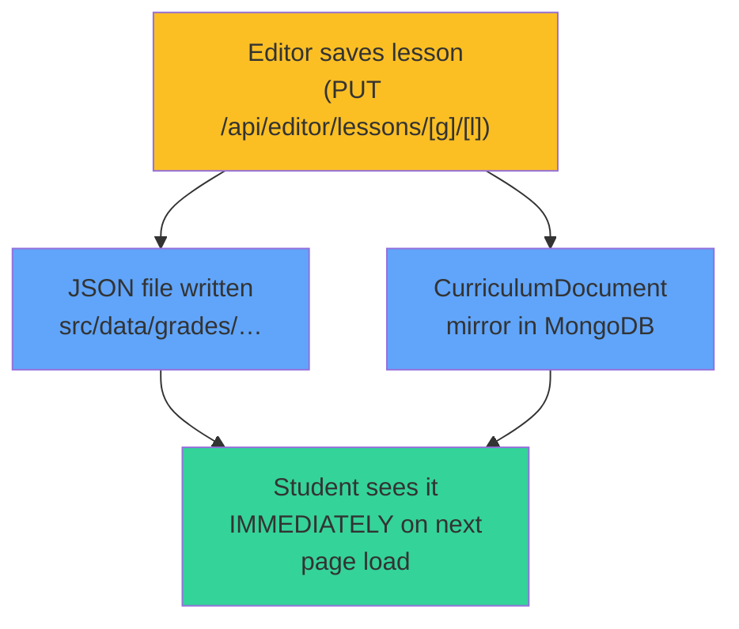
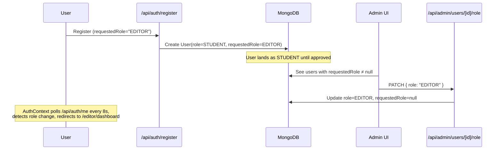
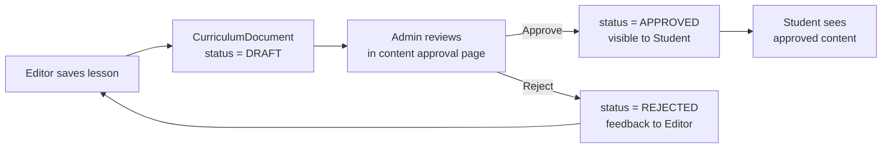

# Intellia360 — Complete Project Architecture Analysis

## A. Project Folder Structure

```
Intellia360/
├── prisma/
│   ├── schema.prisma              ← MongoDB schema (THE database definition)
│   ├── seed.ts                    ← Database seed script
│   └── migrations/
├── src/
│   ├── proxy.ts                   ← Next.js middleware — auth & role routing
│   ├── app/
│   │   ├── layout.tsx             ← Root layout
│   │   ├── page.tsx               ← Public landing page
│   │   ├── (auth)/                ← Auth pages (login, register, etc.)
│   │   ├── api/                   ← All API routes (see Section C)
│   │   │   ├── auth/              ← Auth API (login, register, me, etc.)
│   │   │   ├── editor/            ← Editor API (grades, lessons, curriculum)
│   │   │   ├── admin/             ← Admin API (users, courses, content, etc.)
│   │   │   ├── teacher/           ← Teacher API (assignments, me)
│   │   │   └── student/           ← Student API (progress, quiz, resources)
│   │   ├── editor/                ← Editor pages
│   │   ├── admin/                 ← Admin pages
│   │   ├── teacher/               ← Teacher pages
│   │   └── student/               ← Student pages
│   ├── components/
│   │   ├── admin/                 ← Admin UI components
│   │   ├── auth/                  ← Auth UI components
│   │   ├── common/                ← Shared UI components
│   │   ├── student/               ← Student UI components
│   │   └── teacher/               ← Teacher UI components
│   ├── context/
│   │   ├── AuthContext.tsx         ← Global auth state & session management
│   │   ├── StudentContext.tsx      ← Student dashboard state (curriculum, lessons)
│   │   └── TeacherDataContext.jsx  ← Teacher state (mostly localStorage mock data)
│   ├── data/
│   │   ├── grades/                ← THE CURRICULUM DATA (JSON files, grade1–12)
│   │   │   ├── grade1/
│   │   │   │   ├── curriculum.json   ← Grade curriculum (chapters, topics)
│   │   │   │   ├── dashboard.json    ← Dashboard config (hero, action cards)
│   │   │   │   └── lessons/          ← Individual lesson JSON files
│   │   │   ├── grade2/ … grade12/
│   │   ├── teacher/               ← Teacher mock data
│   │   └── *.json                 ← Static data (quiz, leaderboard, etc.)
│   ├── lib/
│   │   ├── db.ts                  ← Prisma client singleton
│   │   ├── db-filters.ts          ← Reusable Prisma filter helpers
│   │   ├── audit.ts               ← Audit logging
│   │   ├── student-data.ts        ← Student data access layer (static imports)
│   │   ├── assignments.ts         ← Assignment helpers
│   │   ├── auth/                  ← Auth utilities (JWT, session, validation, roles)
│   │   ├── content/               ← Content store layer
│   │   │   ├── curriculum-store.ts  ← Dual file/DB curriculum storage
│   │   │   ├── lesson-store.ts      ← Lesson CRUD operations
│   │   │   ├── lesson-modules.ts    ← Module validation (arch, video, edunotes, practice)
│   │   │   └── lesson-count.ts      ← Grade lesson counting
│   │   ├── editor/
│   │   │   └── require-editor-session.ts ← Editor auth guard
│   │   ├── admin/
│   │   │   ├── require-admin-session.ts  ← Admin auth guard
│   │   │   └── school-stats.ts
│   │   ├── teacher/
│   │   │   ├── require-teacher-session.ts ← Teacher auth guard
│   │   │   └── useLocalStorage.js
│   │   └── student/
│   │       ├── require-student-session.ts ← Student auth guard
│   │       ├── lesson-resources.ts   ← Resolves lesson modules for student view
│   │       ├── lesson-videos.ts      ← Video registry & YouTube parsing
│   │       ├── edunotes.ts           ← EduNotes registry
│   │       ├── practice-quiz.ts      ← Practice quiz logic
│   │       ├── notifications.ts
│   │       └── rewards.ts
│   ├── types/
│   │   ├── auth.ts                ← Auth/user type definitions
│   │   ├── student.ts             ← Student type definitions
│   │   └── api/                   ← API response types
│   └── styles/
│       ├── globals.css
│       └── variables.css
├── next.config.ts
├── package.json
└── docker-compose.yml
```

---

## B. Module-Wise File Map

### EDITOR Module

| File | Purpose |
|------|---------|
| [`layout.tsx`](file:///e:/Vaishnavi/Dnnovate/Intellia360/src/app/editor/layout.tsx) | Editor shell layout with nav |
| [`page.tsx`](file:///e:/Vaishnavi/Dnnovate/Intellia360/src/app/editor/page.tsx) | Editor root (redirects) |
| [`dashboard/page.tsx`](file:///e:/Vaishnavi/Dnnovate/Intellia360/src/app/editor/dashboard/page.tsx) | Editor dashboard |
| [`grades/page.tsx`](file:///e:/Vaishnavi/Dnnovate/Intellia360/src/app/editor/grades/page.tsx) | Grade listing/creation |
| [`lessons/page.tsx`](file:///e:/Vaishnavi/Dnnovate/Intellia360/src/app/editor/lessons/page.tsx) | Lesson listing |
| [`lessons/[gradeId]/[lessonId]/page.tsx`](file:///e:/Vaishnavi/Dnnovate/Intellia360/src/app/editor/lessons/%5BgradeId%5D/%5BlessonId%5D/page.tsx) | **Lesson editor form** (edit modules, metadata) |
| [`courses/page.tsx`](file:///e:/Vaishnavi/Dnnovate/Intellia360/src/app/editor/courses/page.tsx) | Course management |
| [`curriculum/page.tsx`](file:///e:/Vaishnavi/Dnnovate/Intellia360/src/app/editor/curriculum/page.tsx) | Curriculum overview |
| [`curriculum/[gradeId]/page.tsx`](file:///e:/Vaishnavi/Dnnovate/Intellia360/src/app/editor/curriculum/%5BgradeId%5D/page.tsx) | Grade curriculum editor |

### ADMIN Module

| File | Purpose |
|------|---------|
| [`layout.tsx`](file:///e:/Vaishnavi/Dnnovate/Intellia360/src/app/admin/layout.tsx) | Admin layout |
| [`dashboard/page.tsx`](file:///e:/Vaishnavi/Dnnovate/Intellia360/src/app/admin/dashboard/page.tsx) | Admin dashboard |
| [`users/page.tsx`](file:///e:/Vaishnavi/Dnnovate/Intellia360/src/app/admin/users/page.tsx) | **User management & role approval** |
| [`content/page.tsx`](file:///e:/Vaishnavi/Dnnovate/Intellia360/src/app/admin/content/page.tsx) | Content library (metadata resources) |
| [`courses/page.tsx`](file:///e:/Vaishnavi/Dnnovate/Intellia360/src/app/admin/courses/page.tsx) | Course catalogue management |
| [`schools/page.tsx`](file:///e:/Vaishnavi/Dnnovate/Intellia360/src/app/admin/schools/page.tsx) | School management |
| [`students/page.tsx`](file:///e:/Vaishnavi/Dnnovate/Intellia360/src/app/admin/students/page.tsx) | Student management |
| [`teachers/page.tsx`](file:///e:/Vaishnavi/Dnnovate/Intellia360/src/app/admin/teachers/page.tsx) | Teacher management |
| [`analytics/page.tsx`](file:///e:/Vaishnavi/Dnnovate/Intellia360/src/app/admin/analytics/page.tsx) | Analytics |
| [`reports/page.tsx`](file:///e:/Vaishnavi/Dnnovate/Intellia360/src/app/admin/reports/page.tsx) | Reports |
| [`payments/page.tsx`](file:///e:/Vaishnavi/Dnnovate/Intellia360/src/app/admin/payments/page.tsx) | Payment management |
| [`settings/page.tsx`](file:///e:/Vaishnavi/Dnnovate/Intellia360/src/app/admin/settings/page.tsx) | Platform settings |
| [`profile/page.tsx`](file:///e:/Vaishnavi/Dnnovate/Intellia360/src/app/admin/profile/page.tsx) | Admin profile |

### TEACHER Module

| File | Purpose |
|------|---------|
| [`layout.tsx`](file:///e:/Vaishnavi/Dnnovate/Intellia360/src/app/teacher/layout.tsx) | Teacher layout with TeacherDataProvider |
| [`dashboard/page.tsx`](file:///e:/Vaishnavi/Dnnovate/Intellia360/src/app/teacher/dashboard/page.tsx) | Teacher dashboard |
| [`analytics/page.tsx`](file:///e:/Vaishnavi/Dnnovate/Intellia360/src/app/teacher/analytics/page.tsx) | Analytics |
| [`ai-planner/page.tsx`](file:///e:/Vaishnavi/Dnnovate/Intellia360/src/app/teacher/ai-planner/page.tsx) | AI lesson planner |
| [`profile/page.tsx`](file:///e:/Vaishnavi/Dnnovate/Intellia360/src/app/teacher/profile/page.tsx) | Teacher profile |
| + directories: `assignments/`, `attendance/`, `classes/`, `lessons/`, `messages/`, `reports/`, `resources/`, `rewards/`, `settings/`, `students/` | Placeholder/stub pages |

### STUDENT Module

| File | Purpose |
|------|---------|
| [`layout.tsx`](file:///e:/Vaishnavi/Dnnovate/Intellia360/src/app/student/layout.tsx) | Student layout with StudentProvider |
| [`dashboard/page.tsx`](file:///e:/Vaishnavi/Dnnovate/Intellia360/src/app/student/dashboard/page.tsx) | Student dashboard (hero, action cards, curriculum) |
| [`lesson/[id]/page.tsx`](file:///e:/Vaishnavi/Dnnovate/Intellia360/src/app/student/lesson/%5Bid%5D/page.tsx) | **Lesson player** (iframes architecture URL) |
| [`lesson/architecture/page.tsx`](file:///e:/Vaishnavi/Dnnovate/Intellia360/src/app/student/lesson/architecture/page.tsx) | Architecture viewer |
| [`lesson/video/page.tsx`](file:///e:/Vaishnavi/Dnnovate/Intellia360/src/app/student/lesson/video/page.tsx) | Video viewer |
| [`lesson/edunotes/page.tsx`](file:///e:/Vaishnavi/Dnnovate/Intellia360/src/app/student/lesson/edunotes/page.tsx) | EduNotes viewer |
| [`daily-quiz/page.tsx`](file:///e:/Vaishnavi/Dnnovate/Intellia360/src/app/student/daily-quiz/page.tsx) | Daily quiz |
| [`quiz/page.tsx`](file:///e:/Vaishnavi/Dnnovate/Intellia360/src/app/student/quiz/page.tsx) | Quiz listing |
| [`quiz/[id]/page.tsx`](file:///e:/Vaishnavi/Dnnovate/Intellia360/src/app/student/quiz/%5Bid%5D/page.tsx) | Quiz player |
| [`courses/page.tsx`](file:///e:/Vaishnavi/Dnnovate/Intellia360/src/app/student/courses/page.tsx) | Course listing |
| [`assignments/page.tsx`](file:///e:/Vaishnavi/Dnnovate/Intellia360/src/app/student/assignments/page.tsx) | Assignments |
| [`leaderboard/page.tsx`](file:///e:/Vaishnavi/Dnnovate/Intellia360/src/app/student/leaderboard/page.tsx) | Leaderboard |
| [`rewards/page.tsx`](file:///e:/Vaishnavi/Dnnovate/Intellia360/src/app/student/rewards/page.tsx) | Rewards |
| [`worksheets/page.tsx`](file:///e:/Vaishnavi/Dnnovate/Intellia360/src/app/student/worksheets/page.tsx) | Worksheets |
| [`notifications/page.tsx`](file:///e:/Vaishnavi/Dnnovate/Intellia360/src/app/student/notifications/page.tsx) | Notifications |
| [`profile/page.tsx`](file:///e:/Vaishnavi/Dnnovate/Intellia360/src/app/student/profile/page.tsx) | Student profile |

---

## C. API Map

### Auth APIs (`/api/auth/`)

| Route | Method | Purpose |
|-------|--------|---------|
| `/api/auth/register` | POST | Register new user (always as STUDENT, stores `requestedRole`) |
| `/api/auth/login` | POST | Login, issue JWT cookie |
| `/api/auth/logout` | POST | Clear session cookie |
| `/api/auth/me` | GET | Get current session user (from JWT cookie) |
| `/api/auth/google` | GET/POST | Google OAuth sign-in |
| `/api/auth/verify-email` | POST | Verify email token |
| `/api/auth/resend-verification` | POST | Resend verification email |
| `/api/auth/forgot-password` | POST | Send password reset email |
| `/api/auth/reset-password` | POST | Reset password via token |
| `/api/auth/change-password` | POST | Change password (authenticated) |

### Editor APIs (`/api/editor/`)

| Route | Method | Purpose |
|-------|--------|---------|
| `/api/editor/grades` | GET/POST | List all grades / create a new grade |
| `/api/editor/grades/[gradeId]` | GET/PUT/DELETE | Grade CRUD |
| `/api/editor/lessons/[gradeId]` | GET | List lessons for a grade |
| `/api/editor/lessons/[gradeId]/[lessonId]` | GET/PUT/PATCH/DELETE | **Lesson CRUD** (save modules, metadata) |
| `/api/editor/curriculum/[gradeId]` | GET/PUT | Grade curriculum CRUD |
| `/api/editor/stats` | GET | Editor dashboard stats |

### Admin APIs (`/api/admin/`)

| Route | Method | Purpose |
|-------|--------|---------|
| `/api/admin/dashboard` | GET | Dashboard stats |
| `/api/admin/users` | GET | List users |
| `/api/admin/users/[userId]` | GET/PATCH/DELETE | User CRUD |
| `/api/admin/users/[userId]/role` | PATCH | **Change user role (approval)** |
| `/api/admin/courses` | GET/POST | Course catalogue |
| `/api/admin/courses/[id]` | GET/PATCH/DELETE | Course CRUD |
| `/api/admin/content` | GET/POST | Content library |
| `/api/admin/content/[id]` | GET/PATCH/DELETE | Content resource CRUD |
| `/api/admin/schools` | GET/POST | School management |
| `/api/admin/schools/[id]` | GET/PATCH/DELETE | School CRUD |
| `/api/admin/settings` | GET/PATCH | Platform settings |
| `/api/admin/stats` | GET | Platform statistics |
| `/api/admin/audit` | GET | Audit logs |
| `/api/admin/payments` | GET | Payment records |
| `/api/admin/reports/export` | GET | Report export |
| `/api/admin/seed-admin` | POST | Seed initial admin |

### Teacher APIs (`/api/teacher/`)

| Route | Method | Purpose |
|-------|--------|---------|
| `/api/teacher/me` | GET | Teacher profile + live class stats |
| `/api/teacher/assignments` | GET/POST | Assignment management |
| `/api/teacher/assignments/[id]` | GET/PATCH/DELETE | Individual assignment |

### Student APIs (`/api/student/`)

| Route | Method | Purpose |
|-------|--------|---------|
| `/api/student/me` | GET | Student profile |
| `/api/student/grade` | GET | Student's grade data |
| `/api/student/lesson-resources` | GET | **Resolved lesson modules** (architecture, video, edunotes) |
| `/api/student/edunotes` | GET | EduNotes availability |
| `/api/student/edunotes/content` | GET | EduNotes PDF content (proxied) |
| `/api/student/videos` | GET | Lesson videos |
| `/api/student/progress` | GET/POST | Lesson progress tracking |
| `/api/student/quiz` | GET | Quiz listing |
| `/api/student/quiz/[quizId]` | GET | Quiz data |
| `/api/student/quiz/submit` | POST | Submit quiz |
| `/api/student/quiz-attempts` | GET | Quiz history |
| `/api/student/daily-quiz` | GET | Daily quiz questions |
| `/api/student/daily-quiz/submit` | POST | Submit daily quiz |
| `/api/student/activities/complete` | POST | Complete activity |
| `/api/student/assignments` | GET | Student assignments |
| `/api/student/badges` | GET | Badge data |
| `/api/student/leaderboard` | GET | Leaderboard data |
| `/api/student/missions` | GET | Missions |
| `/api/student/ai-tutor` | POST | AI tutor chat |
| `/api/student/notifications` | GET | Notification list |
| `/api/student/notifications/[id]` | PATCH | Mark notification read |
| `/api/student/notifications/read-all` | POST | Mark all read |
| `/api/student/notifications/unread-count` | GET | Unread count |

---

## D. Database / Data-Storage Map

### Two Storage Systems

> [!IMPORTANT]
> **Intellia360 uses a DUAL storage system** — this is the most critical architectural fact.

| Storage | Technology | What It Stores | Used By |
|---------|-----------|----------------|---------|
| **MongoDB (Prisma)** | MongoDB via Prisma ORM | Users, profiles, progress, assignments, audit logs, courses, content resources, schools, payments, settings, **CurriculumDocument** mirror | All modules |
| **JSON Files** | `src/data/grades/` filesystem | Curriculum structure, dashboard config, lesson metadata (modules, URLs) | Editor writes, Student reads |

### Key Prisma Models → Their Role

| Model | Purpose | Key Fields |
|-------|---------|------------|
| `User` | All users | `role`, `requestedRole`, `emailVerified`, `deletedAt` |
| `StudentProfile` | Student data | `grade`, `xpPoints`, `learningGems`, `streakDays`, `classId` |
| `TeacherProfile` | Teacher data | `schoolName`, `subject` |
| `ClassGroup` | Teacher's classes | `teacherId`, `grade` |
| `Assignment` | Teacher assignments | `classId`, `lessonId`, `status`, `dueDate` |
| `AssignmentSubmission` | Student submissions | `assignmentId`, `studentId`, `scorePercent` |
| `CompletedLesson` | Lesson progress | `userId`, `lessonId`, `grade` |
| `CompletedActivity` | Activity progress | `userId`, `lessonId`, `activityType` |
| `QuizAttempt` | Quiz results | `userId`, `lessonId`, `quizId`, `scorePercent` |
| `DailyQuizAttempt` | Daily quiz | `userId`, `dateKey`, `score` |
| `Course` | Course catalogue | `grade`, `status` (PUBLISHED/DRAFT) |
| `ContentResource` | Content library | `category`, `url`, `archivedAt` |
| `School` | Schools | `status` (ACTIVE/PENDING/INACTIVE) |
| `CurriculumDocument` | **DB mirror of JSON files** | `path`, `gradeId`, `kind`, `content`, `version`, `checksum` |
| `CurriculumRevision` | Version history | `documentId`, `version`, `content` |
| `AuditLog` | Audit trail | `action`, `entityType`, `before`, `after` |
| `AdminSettings` | Platform config (singleton) | `platformName`, `primaryColor`, etc. |

### JSON File Structure (per grade)

```
src/data/grades/grade1/
├── curriculum.json    ← Chapters, topics, lesson IDs, vercelLinks, actionCards
├── dashboard.json     ← Hero slide config, action card templates
└── lessons/
    ├── counting-up-to-100.json     ← Lesson: title, modules (arch, video, edunotes, practice URLs)
    ├── reading-writing-numbers.json
    └── ...
```

### Lesson JSON Structure (the core data unit)
```json
{
  "id": "counting-up-to-100",
  "title": "Counting numbers up to 100",
  "description": "...",
  "grade": "grade1",
  "modules": {
    "architectureModule": { "enabled": true, "url": "https://example.vercel.app/" },
    "videoLesson":        { "enabled": true, "url": "https://youtube.com/watch?v=..." },
    "practiceModule":     { "enabled": true, "url": "/student/quiz/practice-1" },
    "eduNotes":           { "enabled": true, "url": "/student/lesson/edunotes" }
  },
  "previousLesson": null,
  "nextLesson": { "id": "reading-writing-numbers", "title": "..." }
}
```

---

## E. Editor → Admin → Teacher → Student Flow

> [!CAUTION]
> **There is NO formal approval/verification workflow.** This is the most critical gap identified. Read below for what actually happens.

### What Actually Happens Today



**The flow is:**

1. **Editor** saves lesson data via `PUT /api/editor/lessons/[gradeId]/[lessonId]`
2. **[`require-editor-session.ts`](file:///e:/Vaishnavi/Dnnovate/Intellia360/src/lib/editor/require-editor-session.ts)** checks EDITOR or ADMIN role
3. **[`lesson-modules.ts`](file:///e:/Vaishnavi/Dnnovate/Intellia360/src/lib/content/lesson-modules.ts)** validates module URLs (format only)
4. **[`lesson-store.ts`](file:///e:/Vaishnavi/Dnnovate/Intellia360/src/lib/content/lesson-store.ts)** → **[`curriculum-store.ts`](file:///e:/Vaishnavi/Dnnovate/Intellia360/src/lib/content/curriculum-store.ts)** writes:
   - JSON file to `src/data/grades/[gradeId]/lessons/[lessonId].json`
   - Mirror to `CurriculumDocument` in MongoDB
5. **[`audit.ts`](file:///e:/Vaishnavi/Dnnovate/Intellia360/src/lib/audit.ts)** records action in `AuditLog`
6. **Student** loads lesson → [`lesson-resources.ts`](file:///e:/Vaishnavi/Dnnovate/Intellia360/src/lib/student/lesson-resources.ts) reads the same files
7. **No approval gate exists** — data goes live immediately

### What Admin Actually Manages

The Admin module manages **users and roles**, NOT content approval:

| Admin Action | API | What It Does |
|-------------|-----|-------------|
| Approve role request | `PATCH /api/admin/users/[userId]/role` | Changes `user.role` from STUDENT to EDITOR/TEACHER, clears `requestedRole` |
| Manage courses | `/api/admin/courses` | Course catalogue (title, grade, status=DRAFT/PUBLISHED) — **unconnected to lesson data** |
| Manage content | `/api/admin/content` | Content resource library (metadata + URL) — **separate from editor lessons** |
| View audit log | `/api/admin/audit` | Read-only audit trail of all privileged actions |

### Teacher's Data Source

The Teacher module currently uses **localStorage mock data** from [`TeacherDataContext.jsx`](file:///e:/Vaishnavi/Dnnovate/Intellia360/src/context/TeacherDataContext.jsx), seeded from [`mockData.js`](file:///e:/Vaishnavi/Dnnovate/Intellia360/src/data/teacher/mockData.js). The only real API data comes from `GET /api/teacher/me` for class stats.

---

## F. Approval / Verification Flow

### User Role Approval (the ONLY approval flow that exists)



**Key mechanism:**
- [`roles.ts`](file:///e:/Vaishnavi/Dnnovate/Intellia360/src/lib/auth/roles.ts) line 48: `DEFAULT_ROLE = "STUDENT"` — all new accounts start as STUDENT
- [`AuthContext.tsx`](file:///e:/Vaishnavi/Dnnovate/Intellia360/src/context/AuthContext.tsx) line 64: `ROLE_REQUEST_POLL_MS = 8000` — polls every 8s while upgrade is pending
- [`AuthContext.tsx`](file:///e:/Vaishnavi/Dnnovate/Intellia360/src/context/AuthContext.tsx) line 142: detects role change → sets `roleUpdated = true`

### Content Approval: **DOES NOT EXIST**

> [!WARNING]
> There is **NO** approval status field on lessons, curriculum, or any content data. The `Course` model has a `status` field (`PUBLISHED`/`DRAFT`) but it is **completely unconnected** to the lesson JSON files that students actually see. The `ContentResource` model has an `archivedAt` field but this is an Admin-only content library, not the editor's lessons.

---

## G. Authentication / Role Flow

### Session Mechanism

| Component | File | Function |
|-----------|------|----------|
| JWT creation | [`jwt.ts`](file:///e:/Vaishnavi/Dnnovate/Intellia360/src/lib/auth/jwt.ts) | Signs JWT with `AUTH_JWT_SECRET` |
| Session read | [`session.ts`](file:///e:/Vaishnavi/Dnnovate/Intellia360/src/lib/auth/session.ts) | Reads `intellia_session` httpOnly cookie |
| Middleware | [`proxy.ts`](file:///e:/Vaishnavi/Dnnovate/Intellia360/src/proxy.ts) | Enforces role-based route access on every request |
| Client state | [`AuthContext.tsx`](file:///e:/Vaishnavi/Dnnovate/Intellia360/src/context/AuthContext.tsx) | Session state, login/logout, role polling |

### Role → Area Access Matrix

| Role | `/student/*` | `/teacher/*` | `/editor/*` | `/admin/*` |
|------|:---:|:---:|:---:|:---:|
| STUDENT | ✅ | ❌ | ❌ | ❌ |
| PARENT | ✅ | ❌ | ❌ | ❌ |
| TEACHER | ❌ | ✅ | ❌ | ❌ |
| SCHOOL | ❌ | ✅ | ❌ | ❌ |
| EDITOR | ❌ | ❌ | ✅ | ❌ |
| ADMIN | ✅ | ✅ | ✅ | ✅ |

### API Auth Guards

| Guard | File | Roles Allowed |
|-------|------|--------------|
| `requireEditorSession()` | [`require-editor-session.ts`](file:///e:/Vaishnavi/Dnnovate/Intellia360/src/lib/editor/require-editor-session.ts) | EDITOR, ADMIN |
| `requireAdminSession()` | [`require-admin-session.ts`](file:///e:/Vaishnavi/Dnnovate/Intellia360/src/lib/admin/require-admin-session.ts) | ADMIN |
| `requireTeacherSession()` | [`require-teacher-session.ts`](file:///e:/Vaishnavi/Dnnovate/Intellia360/src/lib/teacher/require-teacher-session.ts) | TEACHER, SCHOOL, ADMIN |
| `requireStudentSession()` | [`require-student-session.ts`](file:///e:/Vaishnavi/Dnnovate/Intellia360/src/lib/student/require-student-session.ts) | STUDENT, PARENT, ADMIN |

---

## H. Important Functions / Files

### Critical Data Path Functions

| Function | File | What It Does |
|----------|------|-------------|
| `saveLesson()` | [`lesson-store.ts`](file:///e:/Vaishnavi/Dnnovate/Intellia360/src/lib/content/lesson-store.ts) | Writes lesson JSON + mirrors to DB |
| `writeStoreDocument()` | [`curriculum-store.ts`](file:///e:/Vaishnavi/Dnnovate/Intellia360/src/lib/content/curriculum-store.ts) | Dual write: file + CurriculumDocument |
| `mirrorCurriculumWrite()` | [`curriculum-store.ts`](file:///e:/Vaishnavi/Dnnovate/Intellia360/src/lib/content/curriculum-store.ts) | DB upsert with version history |
| `readStoreDocument()` | [`curriculum-store.ts`](file:///e:/Vaishnavi/Dnnovate/Intellia360/src/lib/content/curriculum-store.ts) | Reads from file or DB mirror |
| `resolveLessonResources()` | [`lesson-resources.ts`](file:///e:/Vaishnavi/Dnnovate/Intellia360/src/lib/student/lesson-resources.ts) | Resolves arch/video/edunotes URLs for student |
| `validateLessonModules()` | [`lesson-modules.ts`](file:///e:/Vaishnavi/Dnnovate/Intellia360/src/lib/content/lesson-modules.ts) | Validates module URLs (format + CSP) |
| `normalizeLessonModules()` | [`lesson-modules.ts`](file:///e:/Vaishnavi/Dnnovate/Intellia360/src/lib/content/lesson-modules.ts) | Normalizes missing modules to `{enabled:false, url:""}` |
| `getResolvedActionCards()` | [`student-data.ts`](file:///e:/Vaishnavi/Dnnovate/Intellia360/src/lib/student-data.ts) | Maps modules to dashboard action cards |
| `getLessonMetadata()` | [`student-data.ts`](file:///e:/Vaishnavi/Dnnovate/Intellia360/src/lib/student-data.ts) | Looks up lesson by ID in static map |

---

## I. Current Issues & Inconsistencies

### 🔴 Critical Issues

1. **No content approval workflow** — Editor saves go live immediately to students. There is no "draft/review/approved" pipeline for lesson content.

2. **Dual/contradictory architecture URL source in student lesson page** — [`lesson/[id]/page.tsx`](file:///e:/Vaishnavi/Dnnovate/Intellia360/src/app/student/lesson/%5Bid%5D/page.tsx) has a **hardcoded** `LESSON_ARCHITECTURE_URLS` map (line 12-21) that overrides the API-resolved URLs from `lesson-resources.ts`. The student lesson page does NOT call `/api/student/lesson-resources` — it uses the hardcoded map directly.

3. **`student-data.ts` uses static imports** — [`student-data.ts`](file:///e:/Vaishnavi/Dnnovate/Intellia360/src/lib/student-data.ts) statically imports lesson JSONs at build time. Editor changes to JSON files are NOT reflected until rebuild/restart. This contradicts the `lesson-resources.ts` API which reads at request time.

4. **Course model is disconnected** — The `Course` Prisma model with `status: PUBLISHED/DRAFT` is managed by Admin but has **zero connection** to the lesson JSON files that students actually consume. Two parallel content systems exist with no link.

5. **Teacher uses localStorage mock data** — [`TeacherDataContext.jsx`](file:///e:/Vaishnavi/Dnnovate/Intellia360/src/context/TeacherDataContext.jsx) stores all classes, students, assignments, messages in localStorage from hardcoded seed data. Only `GET /api/teacher/me` uses real DB data.

### 🟡 Moderate Issues

6. **No grade awareness per-student** — [`student-data.ts`](file:///e:/Vaishnavi/Dnnovate/Intellia360/src/lib/student-data.ts) line 19: `CURRENT_GRADE = "grade1"` is hardcoded. The `StudentProfile.grade` field exists in DB but the dashboard doesn't use it to dynamically load grade-specific content.

7. **Missing `editorModule` component** — No dedicated editor components directory exists under `src/components/`. All editor UI is inline in page files.

8. **Inconsistent lesson ID mapping** — Curriculum topics use IDs like `counting-numbers-up-to-100` while lesson files use `counting-up-to-100`. The `resolveLessonResources()` function handles this with title-based fallback matching, but the student lesson page's hardcoded map does not.

9. **Console.log left in production code** — [`student-data.ts`](file:///e:/Vaishnavi/Dnnovate/Intellia360/src/lib/student-data.ts) lines 284-285 have debug `console.log` statements for EduNotes.

10. **`ContentResource` model is parallel to editor content** — The Admin can create `ContentResource` entries (category: edunotes/videos/visual-models) but these are not used by the student lesson viewer — it reads from the editor's JSON files and hardcoded registries instead.

---

## J. Files That Need Changes for Future Modifications

### To add content approval workflow:
- [`schema.prisma`](file:///e:/Vaishnavi/Dnnovate/Intellia360/prisma/schema.prisma) — Add approval status fields to `CurriculumDocument`
- [`lesson-store.ts`](file:///e:/Vaishnavi/Dnnovate/Intellia360/src/lib/content/lesson-store.ts) — Filter by approval status on read
- [`curriculum-store.ts`](file:///e:/Vaishnavi/Dnnovate/Intellia360/src/lib/content/curriculum-store.ts) — Write with draft status
- [`lesson-resources.ts`](file:///e:/Vaishnavi/Dnnovate/Intellia360/src/lib/student/lesson-resources.ts) — Only resolve approved content
- New admin API routes for approval actions
- Editor lesson page — show approval status

### To fix the student lesson page:
- [`student/lesson/[id]/page.tsx`](file:///e:/Vaishnavi/Dnnovate/Intellia360/src/app/student/lesson/%5Bid%5D/page.tsx) — Remove hardcoded URLs, use `/api/student/lesson-resources`

### To make grade dynamic:
- [`student-data.ts`](file:///e:/Vaishnavi/Dnnovate/Intellia360/src/lib/student-data.ts) — Remove `CURRENT_GRADE` hardcode, read from student profile
- [`StudentContext.tsx`](file:///e:/Vaishnavi/Dnnovate/Intellia360/src/context/StudentContext.tsx) — Load grade from API

### To connect teacher to real data:
- [`TeacherDataContext.jsx`](file:///e:/Vaishnavi/Dnnovate/Intellia360/src/context/TeacherDataContext.jsx) — Replace localStorage with API calls
- New teacher APIs for classes, students, curriculum

---

## K. Recommended Architecture / Flow

### Recommended Content Pipeline



### Recommended Single Source of Truth

| Data Type | Current Source | Recommended Source |
|-----------|--------------|-------------------|
| Lesson content & modules | JSON files (primary) + CurriculumDocument mirror | **CurriculumDocument** (DB only — single source) |
| Curriculum structure | JSON files + DB mirror | **CurriculumDocument** (DB only) |
| Architecture URLs | Hardcoded map in student page + lesson JSON | **Lesson JSON `modules.architectureModule.url`** via API |
| Video URLs | Hardcoded registry + lesson JSON + curriculum `actionCards` | **Lesson JSON `modules.videoLesson.url`** via API |
| EduNotes | Hardcoded registry + lesson JSON | **Lesson JSON `modules.eduNotes.url`** via API |
| Student grade | Hardcoded `CURRENT_GRADE = "grade1"` | **`StudentProfile.grade`** from DB |
| Teacher data | localStorage mock | **Database** via Teacher APIs |
| User roles/approval | `User.role` + `User.requestedRole` | Current approach is correct ✅ |

### Key Architecture Principle

> **The database (`CurriculumDocument`) should be the ONLY source of truth for all curriculum/lesson data.** The JSON files should be treated as seed data or a build-time cache, never as the writable store. The student page should always call the API, never use static imports or hardcoded maps.
